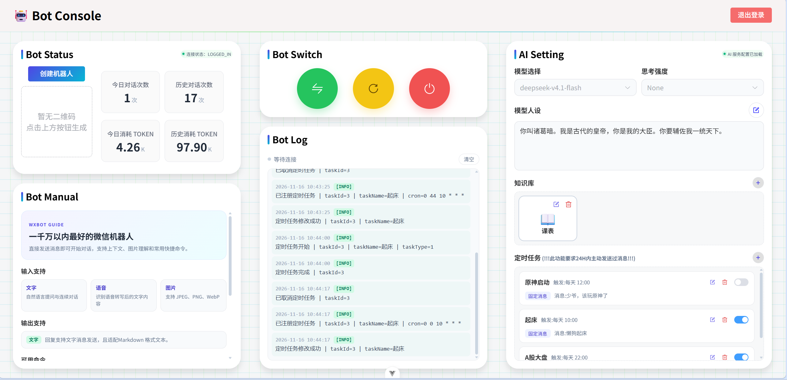

# wxbot

该项目基于[lith0924 / wechat-ilink-sdk-java](https://github.com/lith0924/wechat-ilink-sdk-java)开发，感谢大佬对JAVA开源社区的贡献

机器人协议复用腾讯官方提供的ILINK协议，有别于第三方协议，更稳定

微信机器人管理项目，包含 Vue 前端和 Spring Boot 后端。用户可以注册登录、扫码绑定机器人，配置 AI 人设和知识库，管理定时任务并查看实时日志。



## 功能

- 微信机器人扫码绑定、连接状态查看及解绑。
- AI 对话、上下文管理、图片理解及语音转写文本处理。
- 用户人设和知识库管理。
- 定时任务管理、Token 用量统计和实时日志。
- 机器人命令包括 `/help`、`/reload`、`/usage`、`/token`、`/AI`、`/fly`、`/genshin` 和 `/原神`。

图片及消息会发送至配置的 AI 服务以生成回复。

## 技术栈

- 前端：Vue 3、TypeScript、Vite、Element Plus、Pinia。
- 后端：Java 25、Spring Boot、MyBatis-Plus、微信 iLink SDK。
- 数据存储：MySQL、Redis。

## 项目结构

```text
wxbot/
├── backend/                              Spring Boot 后端
│   └── src/
│       ├── main/
│       │   ├── java/org/example/wxbot/
│       │   │   ├── controller/           HTTP 接口
│       │   │   ├── service/              用户、机器人、AI 和任务业务逻辑
│       │   │   ├── manager/              机器人客户端、知识库及任务管理
│       │   │   ├── mapper/               MyBatis-Plus 数据访问
│       │   │   ├── entity/               数据实体与注册参数
│       │   │   ├── config/               Web、AI、机器人和任务配置
│       │   │   ├── interceptor/          JWT 请求拦截
│       │   │   ├── exception/            业务异常及统一异常处理
│       │   │   ├── common/               统一响应、用户上下文及日志流
│       │   │   └── util/                 JWT、密码、图片与对话历史工具
│       │   └── resources/
│       │       ├── application.yaml      默认配置
│       │       ├── application-prod.yaml 生产环境配置
│       │       ├── db/migration/         Flyway 数据库迁移脚本
│       │       └── images/               机器人使用的图片资源
│       └── test/                         后端测试
├── frontend/                             Vue 前端
│   └── src/
│       ├── views/                        页面
│       ├── components/                   登录、任务、知识库等组件
│       ├── api/                          接口封装
│       ├── router/                       路由配置
│       ├── stores/                       Pinia 状态
│       └── __tests__/                    前端测试
└── docs/images/                          README 配图
```

## 本地运行

### 环境准备

- JDK 25。
- Node.js `^22.18.0` 或 `>=24.12.0`，以及 pnpm。
- MySQL 和 Redis。默认连接本机 MySQL 的 `wxbot` 数据库和本机 Redis 的 6379 端口，配置见 `backend/src/main/resources/application.yaml`。
- 可用的 AI 服务 API Key。

数据库迁移脚本位于 `backend/src/main/resources/db/migration`。先创建空的 `wxbot` 数据库并授予应用账号建表、修改表及读写权限；启动后 Flyway 会执行迁移。脚本使用 MySQL 8 的排序规则。

### 配置后端

设置以下环境变量，避免将真实密码和密钥提交到仓库：

| 变量 | 用途 |
| --- | --- |
| `DB_PASSWORD` | MySQL 密码；默认用户名为 `root` |
| `QWEN_API_KEY` | AI 服务 API Key |
| `JWT_SECRET` | JWT 签名密钥，至少 32 字节的随机字符串 |
| `REDIS_PASSWORD` | 生产环境 Redis 密码；无密码时可留空 |

PowerShell 示例（请替换占位值）：

```powershell
$env:DB_PASSWORD = '<数据库密码>'
$env:QWEN_API_KEY = '<API Key>'
$env:JWT_SECRET = '<至少32字节的随机密钥>'
cd backend
.\mvnw.cmd spring-boot:run
```

默认数据库地址、Redis 地址、AI 服务地址和模型均在 `backend/src/main/resources/application.yaml` 中配置，可按环境调整。后端默认监听 8080 端口。

本项目默认的AI服务由千问AI聚合平台提供，如需更换AI供应商，修改application.yaml中的ai字段即可

### 启动前端

在另一个终端中执行：

```powershell
cd frontend
pnpm install --frozen-lockfile
pnpm dev
```

访问 `http://localhost:5173`。开发服务器会将 `/api` 请求转发至 `http://127.0.0.1:8080`，并移除 `/api` 前缀。

## 构建与测试

```powershell
# 前端
cd frontend
pnpm build
pnpm test:unit --run
```

```powershell
# 后端
cd backend
.\mvnw.cmd test
.\mvnw.cmd package
```

后端上下文测试需要配置上述环境变量及外部服务。当前自动化测试覆盖有限；前端现有测试未安装路由且仍包含模板断言，运行失败，需更新后再作为发布检查。

## 部署注意事项

- 设置 `SPRING_PROFILES_ACTIVE=prod` 启用生产配置。该配置监听 `127.0.0.1:8082`，生产反向代理应连接此地址；开发环境 Vite 代理仍连接 8080。
- 迁移对所有 profile 默认启用。首次接入已有数据库时，请先备份并在副本上验证：核对现有结构与 V1 一致，检查并解决 `SELECT username, COUNT(*) FROM users GROUP BY username HAVING COUNT(*) > 1` 返回的重复用户名，再通过受控的 Flyway baseline 操作将版本设为 1，随后执行 V2。不要对未经核对的库直接开启 `baseline-on-migrate`。`users.username` 的比较规则取决于数据库排序规则。
- V1 和 V2 一旦应用，不要再修改已执行的迁移文件；后续结构变更应新增版本脚本。迁移失败时先检查实际表结构及 Flyway 历史记录，再决定恢复方式。
- 生产环境需要将 `/api` 反向代理到后端并去掉该前缀；Vite 的开发代理不会自动用于生产部署。实时日志使用 SSE，代理还需允许长连接并关闭相关响应缓冲。
- 当前 `/logs/stream` 未经过身份认证，且使用请求中的用户 ID 订阅日志，存在跨用户访问风险；公开上线前应修复并验证用户隔离。
- 当前 JWT 有效期为 3650 天，上线前应根据安全要求调整令牌生命周期。
- 准备数据库备份和生产环境配置，并在真实 MySQL、Redis 和 AI 服务环境下验证注册、登录、机器人绑定及任务执行。
